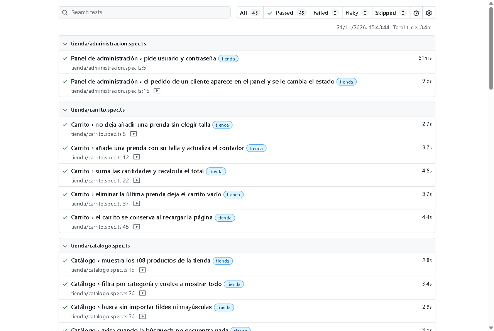
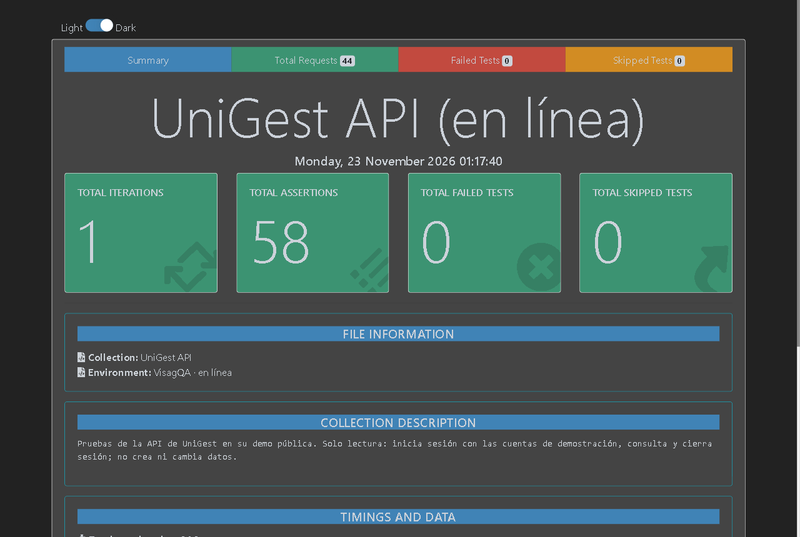

# VisagQA

[](https://github.com/stiven-triana-dev/VisagQA/actions/workflows/pruebas.yml)

Pruebas automáticas **de punta a punta** para mis proyectos: **VisagShop** (la tienda), **VisagStock**
(su inventario), **UniGest** (sistema académico) y **VisagAssist** (asistente con IA).

Cada proyecto ya tiene pruebas por dentro (unitarias y de integración). Lo que faltaba era probarlos
**desde afuera, como los usa una persona**: abrir la página, buscar, elegir talla, llenar el formulario,
iniciar sesión con cada rol. Y también **por debajo, directamente contra sus APIs**, con Postman. Eso es
lo que hace este repositorio, como lo haría un analista QA.



## Estado

| Etapa | Qué cubre | Estado |
| --- | --- | --- |
| 1 | VisagShop: catálogo, carrito, pedido, cuentas y panel | ✅ 27 pruebas |
| 2 | VisagStock (administrador e invitado) y UniGest (tres roles) | ✅ 18 pruebas |
| 3 | APIs de las cuatro aplicaciones con Postman y Newman | ✅ 97 peticiones, 117 comprobaciones |
| 4 | GitHub Actions, prueba diaria en línea y reportes | ✅ En cada cambio y de lunes a viernes |

**45 pruebas de navegador y 117 comprobaciones de API. Encontraron 6 errores reales, y ya están corregidos
en cada proyecto.**

## Tres grupos de pruebas

| Grupo | Contra qué corre | Regla |
| --- | --- | --- |
| `tienda` | Una **copia de VisagShop** con una base PostgreSQL de prueba | Aquí sí se escriben datos: pedidos, cuentas, cambios de estado. |
| `inventario` | Una **copia de VisagStock sobre la misma base** de la tienda de prueba | Igual que en producción: VisagStock lee los productos y tallas que creó VisagShop. Es una prueba de integración entre las dos aplicaciones. |
| `en-linea` | Las aplicaciones **publicadas** (UniGest y VisagStock) | **Solo lectura.** Las ven reclutadores, así que no se crea ni se cambia nada: UniGest solo se consulta y en VisagStock se usa la cuenta de invitado, que nunca guarda. |

### `tienda` — VisagShop

| Archivo | Pruebas |
| --- | --- |
| `catalogo.spec.ts` | Los 108 productos, filtro por categoría, búsqueda sin tildes ni mayúsculas, búsqueda sin resultados, orden por precio, detalle con precio y tallas, página 404, letreros en español. |
| `carrito.spec.ts` | No deja añadir sin talla, contador, suma de cantidades y total, eliminar, el carrito se conserva al recargar. |
| `pedido.spec.ts` | Carrito vacío no se puede confirmar, campos obligatorios, **pedido completo** con el mensaje de WhatsApp, el servidor **ignora un precio falso**, rechaza tallas que no existen y cantidades fuera de 1 a 99. |
| `cuentas.spec.ts` | Perfil sin sesión, contraseña débil, registro, correo repetido, iniciar y cerrar sesión, que el inicio de sesión **no revele qué correos existen**, el pedido aparece en "Tus pedidos". |
| `administracion.spec.ts` | El panel pide usuario y contraseña; el pedido aparece en el panel y se le cambia el estado. |

WhatsApp **siempre queda bloqueado**: la prueba lee el mensaje que se iba a enviar (número de pedido,
prenda, talla, datos y total) pero no sale nada.

### `inventario` — VisagStock como administrador

Contraseña incorrecta; los 108 productos y las tallas que vienen de VisagShop; un **ingreso real** sube
el stock y queda en el kárdex; no deja despachar más de lo que hay; una **devolución dañada** queda
registrada sin volver a la venta; el aviso de **stock bajo** aparece en el resumen; en el celular el
kárdex se ve como tarjetas. Cada prueba lee primero el stock actual, así funcionan aunque la base ya
tenga movimientos de ejecuciones anteriores.

### `en-linea` — UniGest y VisagStock publicados

- **UniGest:** sin sesión la API no entrega datos; con una contraseña incorrecta no entra y lo explica;
  el **administrador** ve el resumen y el directorio; el **docente** y el **estudiante** entran a su
  portal y reciben **403** si piden datos de administración, y si intentan abrir el panel vuelven a su
  portal; la pantalla de entrada no muestra textos del modo de desarrollo; el logo se ve.
- **VisagStock como invitado:** entra sin contraseña, ve los productos, un ingreso de prueba muestra el
  resultado pero el stock **no cambia**, y tampoco deja simular un despacho mayor al stock.

Cada prueba guarda **una captura y un video**, y si falla, también la traza paso a paso.

## Pruebas de API con Postman y Newman

Las pruebas de navegador revisan lo que ve una persona; las de API revisan **lo que responde el servidor**:
el código (200, 401, 403, 409…), los datos y los mensajes. Son más rápidas y llegan a casos que la
pantalla no deja hacer, como mandar un precio falso o pedir el boletín de otro estudiante.

Las colecciones están en `postman/` y **se pueden importar en la aplicación de Postman** (Importar →
elegir el archivo) junto con su entorno. Newman las ejecuta desde la terminal.

| Colección | Dónde | Qué comprueba | Peticiones | Comprobaciones |
| --- | --- | --- | --- | --- |
| **UniGest API** | En línea, solo lectura | Estado y versión; sin sesión **401**; sin token CSRF **403**; contraseña incorrecta **401**; los tres roles con su rol correcto; el administrador lista estudiantes (con sus campos), programas y boletines; el estudiante y el docente reciben **403** en todo lo ajeno, **incluido el boletín de otro estudiante (IDOR)**; cerrar sesión. | 44 | 58 |
| **VisagStock API** · invitado | En línea | Sin sesión **401**; cookie `HttpOnly` y `SameSite=Strict`; resumen con los 108 productos; búsqueda; producto inexistente **404**; ingreso simulado que **no cambia el stock**; despacho mayor al stock **409**; datos mal formados **400** campo por campo; petición desde otro sitio **403**. | 15 | 19 |
| **VisagStock API** · administrador | Copia local | Contraseña incorrecta **401** sin cookie; ingreso real **201** que aparece primero en el kárdex; despacho imposible **409**. | 7 | 7 |
| **VisagShop API** | Copia local | Registro; el inicio de sesión responde **exactamente lo mismo** exista o no el correo; pedido que **ignora un precio falso**; talla inexistente y 100 unidades **400**; pedido desde otro sitio **403**; panel sin clave **401**; cambio de estado de un pedido y estado inválido **400**. | 16 | 17 |
| **VisagAssist API** | En línea | Estado del servicio y de su base; búsqueda por texto, categoría, precio máximo y orden; límites de 1 a 20 resultados **422**; conversación inexistente **404** y mal formada **422**; pase de identidad falso **401**; mensaje vacío o de más de 500 caracteres **422**. | 15 | 16 |

**El chat de VisagAssist nunca recibe una pregunta real**: cada una gasta la cuota gratuita de Gemini. Las
pruebas solo usan peticiones que el servidor rechaza antes de llamar a la IA (pase falso, mensaje vacío o
demasiado largo).



## Errores que encontraron al hacer las pruebas

| Proyecto | Hallazgo | Por qué importa | Corrección |
| --- | --- | --- | --- |
| VisagShop | El detalle de cada producto decía **"VISAGSHOP / STREETWEAR COLLECTION"**. | En el Sprint 7 se decidió usar "ropa urbana" en vez de "streetwear"; este letrero se escapó. | Ahora dice «VISAGSHOP / COLECCIÓN URBANA». |
| VisagShop | Al iniciar sesión respondía **"No hay una cuenta registrada con este correo"** o **"La contraseña no es correcta"** según el caso. | Con esos dos mensajes alguien puede averiguar qué correos tienen cuenta (enumeración de usuarios). | Los dos casos responden «El correo o la contraseña no son correctos.» y **tardan lo mismo**. |
| UniGest | El **logo no se veía**. | Un script que usé para quitar comentarios abrió el PNG como texto y lo guardó dañado: sus primeros bytes pasaron de `89 50 4E 47` a `EF BF BD`. | Lo recuperé del historial de git y revisé los 357 archivos binarios de mis 6 proyectos: era el único dañado. |
| UniGest | La demo pública mostraba **"Entorno local de desarrollo"** y **"Datos del servidor local"**. | Eran los textos iniciales de la página y solo cambiaban cuando confirmaba el modo demo. | Ahora arranca con textos neutros y solo dice "Entorno local" cuando de verdad lo es. |
| UniGest | Con una contraseña incorrecta decía **"La sesión no es válida o ha expirado."** | La persona no tenía sesión: solo escribió mal la clave. Todos los errores 401 compartían ese mensaje. | En el inicio de sesión ahora dice «El correo o la contraseña no son correctos.». |
| UniGest | La API de estado decía **versión "0.3.0"**, pero el proyecto va en la **0.11.0** (encontrado con Postman). | La versión estaba escrita a mano en cuatro lugares y una se quedó atrás. | El estado y la documentación leen la versión del `pom.xml` al compilar (`build-info` de Spring Boot), con una prueba de Java que lo verifica. Probé el cambio en una rama temporal: las 101 pruebas pasaron en GitHub antes de publicarlo. |

Primero dejé cada prueba **fallando a propósito** (una prueba de QA que falla por un error real está
haciendo su trabajo), después corregí el proyecto y ahora pasan. Si un error vuelve, la prueba lo detecta.

## Automatización con GitHub Actions

Las pruebas corren solas en GitHub, sin abrir mi computador. Están en
[`.github/workflows/pruebas.yml`](.github/workflows/pruebas.yml).

| Trabajo | Cuándo corre | Qué hace |
| --- | --- | --- |
| **Navegador · tienda e inventario** | En cada cambio que subo y a mano | Descarga VisagShop y VisagStock, los arranca sobre un PostgreSQL temporal y corre las 35 pruebas de `tienda` e `inventario`. |
| **API · copias locales** | En cada cambio que subo y a mano | Lo mismo, con su propia base, y corre las colecciones de VisagShop y VisagStock administrador. |
| **En línea** | **De lunes a viernes a las 7:00 a. m.** (hora de Colombia) y a mano | Corre las 10 pruebas de `en-linea` y las APIs de UniGest, VisagStock invitado y VisagAssist contra lo publicado. Si una aplicación se cae, el sello de arriba se pone rojo. |

- **Ninguna clave real:** las copias usan las mismas claves de prueba de siempre y una base que se borra al
  terminar. Lo publicado solo se lee.
- **Reportes:** cada corrida guarda el reporte de Playwright (capturas, videos y trazas), los reportes de
  Newman y los registros de los servidores. Se descargan en la pestaña **Actions**, al final de cada
  corrida, durante 14 días.
- **Arrancar las copias** es una acción propia,
  [`.github/actions/copias-locales`](.github/actions/copias-locales/action.yml), que usan los dos trabajos
  locales: primero la tienda (crea las tablas y carga los 108 productos) y después el inventario, que se
  apoya en esas tablas.

## Cómo correrlo

Necesitas **Node.js 22.12 o superior** y, para los grupos `tienda` e `inventario`, PostgreSQL con copias
de [VisagShop](https://github.com/stiven-triana-dev/VisagShop) y
[VisagStock](https://github.com/stiven-triana-dev/VisagStock).

```bash
npm install
npx playwright install chromium
```

| Grupo | Qué debe estar corriendo |
| --- | --- |
| `tienda` | VisagShop en `http://localhost:3210` con `ADMIN_USERNAME=admin_qa`, `ADMIN_PASSWORD=clave-admin-qa-2026` y `WHATSAPP_NUMBER=573000000000`. También puede arrancarla Playwright: `TIENDA_DIR=../VisagShop TIENDA_DATABASE_URL=postgres://… npm run test:tienda`. |
| `inventario` | VisagStock en `http://localhost:3220`, sobre la **misma base** de la tienda, con `ADMIN_USERNAME=admin_qa` y `ADMIN_PASSWORD=clave-stock-qa-2026`. |
| `en-linea` y `api:en-linea` | Nada: usan las aplicaciones publicadas. La primera prueba puede tardar hasta 2 minutos mientras Render las despierta. `UNIGEST_URL` permite apuntar a otra copia de UniGest. |

```bash
npm test                  # los tres grupos
npm run test:tienda
npm run test:inventario
npm run test:en-linea
npm run api               # las cinco corridas de Postman con Newman
npm run api:en-linea      # solo UniGest, VisagStock invitado y VisagAssist
npm run api:local         # solo VisagShop y VisagStock administrador (copias locales)
npm run reporte           # abre el reporte con capturas y videos
npm run typecheck         # revisa los tipos de TypeScript
```

## Qué usé y por qué

| Herramienta | Para qué | Por qué la elegí |
| --- | --- | --- |
| **Playwright** | Abrir un navegador real y usar las aplicaciones como una persona | Espera sola a que aparezcan los elementos, graba video y captura, y deja una traza para ver qué pasó cuando algo falla. |
| **TypeScript** | Escribir las pruebas | Avisa errores antes de correr: un nombre mal escrito en una función de apoyo no llega a ejecutarse. |
| **Selectores por rol y nombre** (`getByRole`) | Encontrar botones y campos | Buscan los elementos como los anuncia un lector de pantalla ("botón AÑADIR AL CARRITO"), no por clases de CSS que cambian con el diseño. |
| **Proyectos de Playwright** | Separar `tienda`, `inventario` y `en-linea` | Cada grupo tiene su dirección, sus tiempos de espera (en línea hasta 4 minutos por prueba) y sus reglas. |
| **Sesión guardada** (`storageState`) | Iniciar sesión una vez en el inventario y reutilizarla | VisagStock permite 10 inicios de sesión cada 15 minutos; sin esto, las pruebas chocaban con ese límite. |
| **Fixture propio de WhatsApp** | Bloquear `wa.me` en todas las pruebas de la tienda | Ninguna prueba puede enviar un mensaje real por accidente, y todas pueden leer lo que se iba a enviar. |
| **PostgreSQL de prueba** | Las bases de las copias | Es el mismo motor que usan las aplicaciones en producción (Neon). |
| **Postman** | Escribir las colecciones de API con sus comprobaciones en JavaScript (`pm.test`) | Es la herramienta que más piden las ofertas de QA, y las colecciones se pueden abrir y correr a mano en la aplicación. |
| **Newman** | Ejecutar las colecciones desde la terminal (`scripts/api.mjs`) | Corre lo mismo que Postman sin abrir la aplicación, así se puede automatizar. |
| **GitHub Actions** | Correr todo en cada cambio y de lunes a viernes | Es gratis en repositorios públicos, trae PostgreSQL como servicio y guarda los reportes de cada corrida. |
| **newman-reporter-htmlextra** y JUnit | Reportes de las APIs en `reportes/api/` | El HTML muestra cada petición con su respuesta; el XML JUnit lo entienden herramientas como GitHub Actions. |

## Lo que aprendí

1. **Primero entender, después probar.** Antes de escribir una sola prueba recorrí cada aplicación con
   Playwright y miré qué envía al servidor. Así descubrí que el precio no viaja desde el navegador (solo el
   producto, la talla y la cantidad), y que la forma correcta de probar la seguridad era mandarle al
   servidor un pedido con un precio falso.
2. **No escribir datos en lo que está publicado.** Un pedido de prueba en la tienda real se ve como un
   pedido real, y la demo de UniGest la ven reclutadores. Por eso lo que escribe va contra copias, y lo que
   va en línea solo lee o usa una cuenta que no guarda.
3. **Una prueba que pasa por error es peor que una que falla.** Mi prueba de "no revelar correos" pasó la
   primera vez: leía el mensaje antes de que apareciera. Y mi primera prueba de los textos de desarrollo de
   UniGest revisaba la página **después** de iniciar sesión, cuando el error solo aparecía **antes**.
4. **Investigar antes de reportar.** En UniGest vi la cifra de estudiantes en "—" y parecía un error; con
   más espera mostraba 9: solo tardaba en cargar. No lo reporté. En cambio, el logo que "no cargaba" sí era
   un archivo dañado, y lo confirmé comparando sus primeros bytes.
5. **Los límites de seguridad también afectan a las pruebas.** La tienda permite 10 pedidos y 5 registros
   por hora, y VisagStock 10 inicios de sesión cada 15 minutos. Diseñé las pruebas para gastar pocos: una
   cuenta compartida y una sesión guardada.
6. **Las pruebas deben poder repetirse.** Las del inventario guardan datos de verdad; si esperaban un
   número fijo, la segunda ejecución fallaba. Ahora cada una lee el stock antes de actuar.
7. **El ciclo completo de QA:** la prueba encuentra el error, se corrige en el proyecto y la misma prueba
   pasa a cuidar que no vuelva.
8. **Probar la API llega donde la pantalla no llega.** Con Postman pude mandar un precio falso, pedir el
   boletín de otro estudiante cambiando un número (IDOR) o enviar datos que el formulario no deja escribir.
   Así encontré el sexto error, la versión desactualizada, que ninguna pantalla muestra.
9. **Una prueba de seguridad debe aislar la causa.** Mi primera prueba de IDOR pedía el boletín ajeno sin
   período: el 403 podía deberse a eso. Ahora lo pide con un período válido, así el 403 solo puede venir de
   los permisos.
10. **No gastar lo que cuesta.** Al chat de VisagAssist solo le envío peticiones que se rechazan antes de
    llegar a la IA, y lo verifiqué en el código.
11. **Probar los cambios grandes antes de publicarlos.** El arreglo de la versión tocaba Java; lo subí a una
    rama temporal, esperé las 101 pruebas en GitHub, lo fusioné y borré la rama.
12. **Las pruebas sirven más cuando corren solas.** Con GitHub Actions cada cambio se prueba contra copias
    nuevas de la tienda y del inventario, y cada mañana de lunes a viernes se revisa lo publicado. Separé
    los trabajos para que cada uno arranque con su propia base y sus propios límites: si las pruebas de
    navegador y las de API compartieran la tienda, gastarían juntas los 10 pedidos por hora.

## Problemas que tuve y cómo los resolví

| Problema | Por qué pasaba | Cómo lo resolví |
| --- | --- | --- |
| Varias pruebas fallaban con *strict mode violation* al añadir al carrito. | El aviso "Producto añadido" aparece dos veces en la página (en el detalle y flotante). | La prueba espera el primero de los dos; no es un error de la tienda. |
| No podía elegir el departamento por su etiqueta. | Hay dos campos con la etiqueta "Departamento": el de entrega y el de facturación (oculto). | Lo busco por su rol: la lista desplegable (`combobox`) "Departamento *". |
| Al confirmar el pedido se abría una pestaña de WhatsApp. | El botón abre `wa.me` con el resumen del pedido. | Un *fixture* bloquea `wa.me` en todas las pruebas y guarda el mensaje para revisarlo. |
| Después de explorar, las pruebas fallaban con "Demasiados intentos". | Mis exploraciones gastaron el límite de pedidos por hora de la tienda de prueba. | Reiniciar la tienda (el límite vive en memoria) y gastar menos pedidos por ejecución. |
| La prueba de enumeración de correos pasaba sin deber. | Leía el aviso antes de que la respuesta del servidor lo llenara. | Esperar con `expect(...).not.toBeEmpty()` antes de leerlo. |
| El resumen decía 26 pruebas, pero eran 27. | Las pruebas de cuentas corren en cadena (modo *serial*): cuando una falla, Playwright salta las siguientes. | Al corregir el error se ejecutaron todas. Aprendí a revisar también las pruebas que no corrieron. |
| La prueba de "contraseña incorrecta" del inventario no encontraba el formulario de entrada. | La ventana nueva heredaba la sesión guardada del administrador, así que ya estaba adentro. | Abrirla explícitamente sin sesión: `storageState: { cookies: [], origins: [] }`. |
| La prueba de stock bajo fallaba solo la segunda vez. | El mínimo ya había quedado igual al stock, y el botón "Guardar" solo aparece si el valor cambia. | Guardar solo cuando el valor es distinto. |
| El botón "Entrar" era ambiguo en VisagStock. | También existe "Entrar como invitado". | Buscarlo con el nombre exacto "Entrar ↗". |
| Las pruebas en línea fallaban por tiempo la primera vez. | Render duerme las aplicaciones gratuitas y tarda hasta 2 minutos en despertarlas. | El grupo `en-linea` tiene tiempos de espera mayores (hasta 4 minutos por prueba). |
| En Postman, el ID de la talla llegaba como texto (`"5"`) y el servidor lo rechazaba. | Una variable `{{talla_id}}` dentro del JSON tiene que ir entre comillas para que el JSON sea válido, y entonces se envía como texto. | Un script previo a la petición reemplaza la variable por su número antes de enviarla. |
| UniGest respondía **400** al pedir el boletín como administrador. | El reporte exige el período (`periodoId`). Era un error de mi prueba, no de UniGest. | La colección consulta primero los períodos y usa el más reciente que ya empezó. |
| A mitad de las pruebas la sesión de UniGest se perdió con **401**. | Render estaba reiniciando UniGest para publicar la corrección de la versión. | Esperar a que el estado responda la versión nueva antes de volver a correr las pruebas. |
| No podía probar el trabajo **En línea** en la rama temporal. | Ese trabajo solo corre con el horario o a mano, y el botón para correrlo a mano solo aparece cuando el archivo ya está en `main`. | Mientras probaba, lo activé también para la rama temporal; cuando pasó en verde lo quité y fusioné. |
| TypeScript pedía la extensión `.js` en cada `import`. | Con `moduleResolution: nodenext` los `import` relativos deben llevarla. | Usar `moduleResolution: bundler`, que es como Playwright carga los archivos. |

## Seguridad de las dependencias

`npm audit` avisa de vulnerabilidades en paquetes internos de Newman (por ejemplo `lodash`,
`node-forge` y `csv-parse`). Las revisé: Newman solo corre en mi computador y en GitHub Actions, ejecuta
**mis propias colecciones** contra mis aplicaciones y no recibe datos de terceros ni llega a producción, así
que el riesgo es bajo. Lo dejo escrito en vez de esconderlo, y lo vuelvo a revisar cuando Newman publique
una versión nueva.
